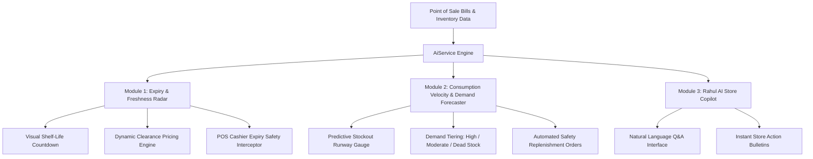

# Rahul Stores - Supermarket Billing System

A **Java + Spring Boot** Object-Oriented POS Web Application for **Rahul Stores**. Open in your browser at `http://localhost:8085`.

## Tech Stack

| Layer     | Technology                              |
|-----------|-----------------------------------------|
| Language  | Java 17+ (OOP Principles)               |
| Backend   | Spring Boot (REST API)                  |
| Frontend  | HTML5 / Vanilla CSS3 / JavaScript (ES6) |
| Database  | MySQL / H2 In-Memory Fallback           |

## OOP Concepts Demonstrated

- **Classes & Objects** — `Product`, `Bill`, `BillItem`, `User`
- **Encapsulation** — Private fields with validation, getters, and setters
- **Inheritance** — Base `AbstractPayment` class extended by concrete strategies
- **Polymorphism** — `PaymentStrategy` interface (`CashPayment`, `UpiPayment`, `CardPayment`)
- **Factory Pattern** — `PaymentFactory` dynamically instantiates payment strategy
- **Abstraction** — DAO layer (`ProductDAO`, `BillDAO`) hides database queries from API controllers

## Features

1. **Multiple Input Methods**:
   - Add product by numeric **Product ID** (e.g. ID `1`, `2`, `5`)
   - Search by **Product Name** or **Barcode**
   - **Webcam Camera Barcode Scanner** modal
   - **USB Hardware Scanner Gun** auto-detection
2. **Payment Modes & Custom QR Code**:
   - **Cash Payment**: Automatic change-return calculator
   - **UPI Payment**: Displays official **Rahul Stores Google Pay QR Code**
   - **Card Payment**: Card type and last 4 digits tracking
3. **Itemized Tax Invoice Receipt**:
   - Pop-up printable thermal invoice receipt with GST calculation, transaction details, and receipt QR code.

---

## How to Run & Open the Website

### Step 1: Open Terminal / PowerShell
Open your terminal and navigate to the project directory:

```powershell
cd "c:\Users\saravana vishal\OneDrive\Desktop\supermarket billing system"
```

### Step 2: Start the Application
Run Maven Spring Boot command:

```powershell
mvn spring-boot:run
```

### Step 3: Open in Browser
Open your web browser (Chrome, Edge, Firefox) and go to:

👉 **http://localhost:8085**

### Step 4: Login Credentials

| Username | Password   | Role    |
|----------|------------|---------|
| admin    | admin123   | Admin   |
| cashier  | cashier123 | Cashier |

---

## AI Implementations & Smart Store Intelligence 🤖

The project implements an **AI-driven Retail Inventory, Freshness & Demand Intelligence Engine** designed to solve two of the biggest problems in retail supermarket management: **perishable inventory waste** and **unexpected out-of-stock situations**.



---

### 1. AI Expiry Tracking & Dynamic Clearance Pricing Engine

#### A. Shelf-Life Classification
Every product's remaining shelf-life $T$ is computed dynamically using temporal difference against the current date:
$$T = \text{Date}_{\text{expiry}} - \text{Date}_{\text{today}} \quad (\text{in days})$$

Products are categorized into 4 operational tiers:
* 🔴 **EXPIRED ($T \le 0$)**: Immediate shelf withdrawal. Blocked from customer sale.
* 🟠 **CRITICAL ($1 \le T \le 7$)**: Imminent danger of 100% loss. Requires flash clearance.
* 🟡 **WARNING ($8 \le T \le 30$)**: Approaching threshold. Targeted for promotional rotation.
* 🟢 **HEALTHY ($T > 30$)**: Optimal freshness. Standard retail operations.

#### B. Dynamic Markdown & Revenue Salvage Algorithm
Without dynamic intervention, expired inventory results in a total write-off:
$$\text{Potential Waste Loss} = \text{Stock Qty} \times \text{Base Price}$$

The AI dynamically calculates promotional markdowns based on urgency:
* **$T \le 3\text{ days}$**: 50% Flash Clearance
* **$4 \le T \le 7\text{ days}$**: 30% Clearance Markdown
* **$8 \le T \le 20\text{ days}$**: 15% Promotional Discount
* **$21 \le T \le 30\text{ days}$**: 10% Observation Markdown

$$\text{Clearance Price} = \text{Base Price} \times \left(1 - \frac{\text{Discount \%}}{100}\right)$$
$$\text{Recovered Capital} = \text{Stock Qty} \times \text{Clearance Price}$$

> **1-Click POS Price Sync**: Clicking **"⚡ Apply AI Discount"** executes an instant transactional update (`productDAO.updatePrice`) allowing immediate clearance sales at checkout.

---

### 2. AI Product Demand Forecasting & Restocking Engine

#### A. Daily Consumption Velocity ($V$)
The engine calculates real-time daily movement by blending actual sales from checkout transactions (`bill_items` over past 30 days) with Bayesian retail baseline velocities:
$$V = \max\left(0.1, \frac{\text{Units Sold in 30 Days}}{30}\right) \quad (\text{units / day})$$

#### B. Predictive Stockout Runway ($R$)
Predicts the exact number of days before inventory hits zero:
$$R = \frac{\text{Current Stock Qty}}{V} \quad (\text{days})$$

* **$R \le 4\text{ days}$**: ⚠️ **Stockout Imminent** (High risk of lost sales & customer dissatisfaction).
* **$V \ge 4\text{ units/day}$**: 🔥 **High-Demand Fast Mover** (Core revenue driver).
* **$R > 60\text{ days}$**: 💤 **Slow-Moving / Dead Stock** (Capital locked up).

#### C. Automated Replenishment Order Calculation ($Q_{\text{reorder}}$)
Using standard economic inventory control with a **14-day lead replenishment cycle**:
$$\text{Target Buffer} = V \times 14\text{ days}$$
$$Q_{\text{reorder}} = \begin{cases} 
\left\lceil \frac{\text{Target Buffer} - \text{Stock Qty}}{5} \right\rceil \times 5, & \text{if Stock Qty} < \text{Target Buffer} \\ 
0, & \text{otherwise} 
\end{cases}$$

---

### 3. Rahul AI Store Copilot (Conversational Assistant)

* **Natural Language Query Parsing**: Accepts free-form queries (e.g., *"What is expiring this week?"*, *"Which items should I reorder?"*, *"Show fastest selling items"*).
* **Intent Extraction**: Identifies domain keywords (`expir*`, `waste`, `demand`, `fast`, `reorder`, `restock`, `savings`) and routes telemetry queries to `AiService`.
* **Telemetry Synthesis**: Generates rich natural language summaries accompanied by structured highlight cards (Product name, status badge, and recommended action).

---

### 4. POS Billing Real-Time Safety Guard

* When a cashier scans or enters a product in `/billing.html`:
  * If the product has an expired date ($T \le 0$), an **AI Safety Modal** immediately intercepts the action, warning the cashier and requiring administrative override.
  * If the product is in critical window ($T \le 7$), an **AI Clearance Alert** toast pops up informing the cashier of available clearance markdowns.

---

### 5. OOP & Design Patterns in the AI Subsystem (Viva / Academic Evaluation)

| Design Pattern / Principle | Implementation in Code |
|----------------------------|------------------------|
| **Service Layer Pattern**  | `AiService.java` encapsulates all domain algorithms, isolating business calculations from the web controllers. |
| **DTO (Data Transfer Object)** | `AiExpiryItem`, `AiExpirySummary`, `AiDemandItem`, `AiDemandSummary`, `AiChatRequest` decouple database rows from JSON client contracts. |
| **Encapsulation & Validation** | `Product.java` encapsulates `expiryDate` and `batchNo` with strict getters/setters and null-safety. |
| **Strategy & Rule Engine** | Discount markdown percentages and demand tier classifications are implemented via algorithmic heuristic strategies. |
| **Persistence Decoupling** | `ProductDAO` abstracts SQL dialect differences between MySQL and embedded H2. |

---

## Website Pages

| Page                  | URL                    | Description                                     |
|-----------------------|------------------------|-------------------------------------------------|
| Home                  | `/`                    | Landing page with POS launch link               |
| Login                 | `/login.html`          | Authentication                                  |
| Dashboard             | `/dashboard.html`      | Sales stats, AI summary & store overview        |
| **AI Intelligence**   | `/ai-insights.html`    | **Smart Expiry Radar, Demand Forecast & Copilot** |
| Billing               | `/billing.html`        | POS checkout, AI safety warnings & receipt      |
| Products              | `/products.html`       | Product inventory with AI Expiry tracking       |
| Monthly Statement     | `/monthly-income.html` | Sales, expenses, P&L statement                  |
| Customers             | `/customers.html`      | Customer CRM and purchase history               |
| Shop Profile          | `/shop.html`           | Store branding, GSTIN, & settings               |
